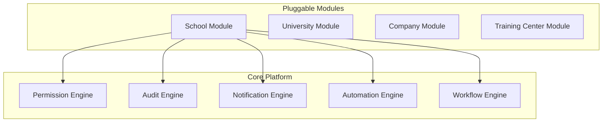

# Ausar Military Enterprise SaaS Platform Architecture

This document describes the high-level architecture of the **Ausar Military Enterprise SaaS Platform**. The platform is built using a decoupled, pluggable core architecture (`Core + Modules`) designed to scale across multiple institution types (Schools, Universities, Companies, Training Centers) without core code modification.

## Core Engines Overview

1. **Permission Engine** (`src/core/permissions/`)
   - Replaces hardcoded role authorization with capability-based checks.
   - Provides a globally available React context provider and `usePermission` hook.

2. **Audit Engine** (`src/core/audit/`)
   - Logs administrative operations and business outcomes.
   - Generates searchable, filterable logs and a visual vertical timeline widget.

3. **Global Notification Engine** (`src/core/notifications/`)
   - Centralizes gateway integrations (SMS, WhatsApp, Email) with stubs for future native mobile Push.
   - Manages asynchronous queues and deliveries.

4. **Automation Engine** (`src/core/automation/`)
   - Enables configuration-driven rule execution (e.g. flagging students after *N* consecutive absences).
   - Resolves all rules dynamically from the active module's manifest.
