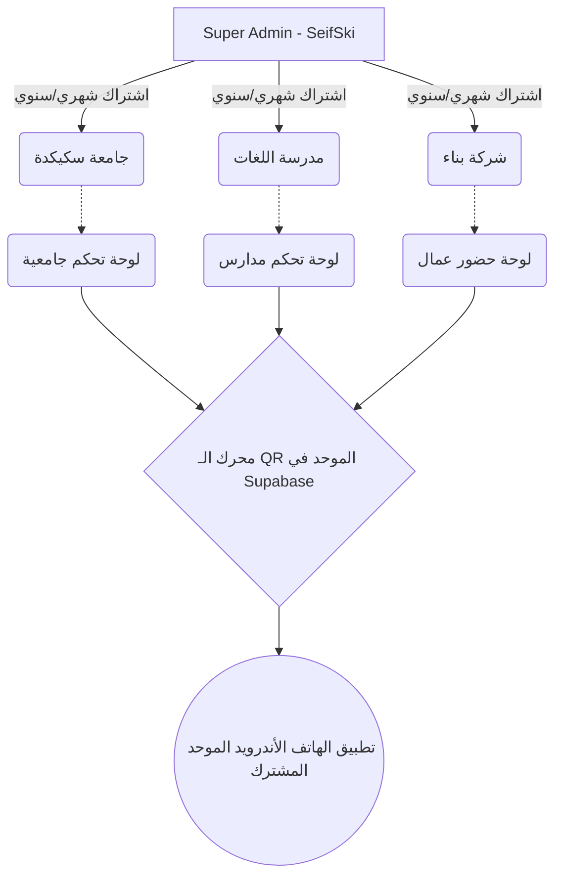

# 🚀 المخطط الهيكلي الإستراتيجي لنظام Ausar Military (نسخة الجزائر الشاملة)

يمثل هذا المستند الرؤية العالمية والمخطط الهندسي (SaaS Architecture) لتحويل نظام تسجيل الحضور من تطبيق جامعي بسيط إلى **المنصة الوطنية الأولى في الجزائر** لتسجيل الحضور وإدارة الكيانات.

---

## 🎯 1. السوق الجزائري المستهدف (Total Addressable Market)

النظام مرن جداً (Scalable) ويمكن بيعه لكل من:

| القطاع | الكيانات المستهدفة في الجزائر | حالة الاستخدام (كيف يستخدمون التطبيق؟) | التخصيص في النظام |
| :--- | :--- | :--- | :--- |
| **وزارة التعليم العالي** | الجامعات، المدارس العليا (ENS, ESI)، المعاهد الوطنية. | الحد من الغش في المدرجات الكبرى (بصمة الجهاز ضرورية). | كليات، أقسام، أفواج، TD/TP. |
| **وزارة التربية الوطنية** | الثانويات، المتوسطات، الابتدائيات. | تسجيل غياب التلميذ وإرسال رسالة SMS/إشعار فوري للولي. | أطوار، سنوات، أقسام، أولياء أمور. |
| **وزارة التكوين المهني** | مراكز CFPA، معاهد INSFP. | تسجيل الغيابات الصارمة للمتربصين في الورشات التطبيقية. | تخصصات حرفية، ورشات، متربصين. |
| **المدارس الخاصة** | المدارس المعتمدة، مدارس الدعم، مدارس اللغات. | تنظيم الدفع وحساب الساعات؛ التلميذ الذي لم يدفع لا يُفتح له الـ QR. | مستويات، مجموعات، دفع شهري. |
| **الإقامات الجامعية (DOU)** | الأحياء الجامعية والمطاعم المركزية. | مسح بطاقة الطالب لمرة واحدة عند الوجبة (لمنع أكل شخص خارجي). | أجنحة، مطعم، رقابة دخول. |
| **مدارس تعليم السياقة** | Auto-écoles. | حساب وتسجيل ساعات الحصص التطبيقية بدقة لكل مترشح. | سيارات، مدربين، امتحانات. |
| **الشركات الكبرى** | سوناطراك، كوسيدار، شركات الحراسة. | تسجيل حضور العمال في الورشات البعيدة ومحاضرات السلامة (HSE). | ورشات عمل، عمال، مسؤولي أمن. |
| **دور الحضانة** | Crèches. | يمسح الولي الرمز عند إحضار وأخذ طفله لضمان الأمان. | أطفال، مربيات، أوقات دخول/خروج. |

---

## 🏗️ 2. الهيكلة التقنية الشاملة (Multi-Tenant SaaS)

لكي يتحمل النظام كل هذه القطاعات في وقت واحد باستعمال رابط واحد وتطبيق هاتف واحد، سنقوم بهندسة النظام إلى **3 طبقات رئيسية (3 Layers)**:

### 👑 الطبقة الأولى: Super Admin (المالك - أنت)
لوحة تحكم خفية ومحمية بشكل مشدد خاصة بك أنت فقط:
- **الصلاحيات:** إنشاء مؤسسة جديدة، تجميد مؤسسة لم تدفع الاشتراك، مراقبة الإيرادات المالية.
- **التفعيل:** عند توقيع عقد مع "مدرسة خاصة X"، تدخل للوحة، تُدخل اسم المدرسة، نوعها، وعدد الطلاب المسموح لهم، وتنقره "تفعيل". النظام يولد رابط دخول وإيميل لمدير المدرسة.

### 🏢 الطبقة الثانية: Tenant Admin (مدير المؤسسة المكتتتبة)
يدخل مدير "مدرسة خاصة X" بإطمئنان ولن يرى أبداً بيانات "جامعة سكيكدة".
- **عزل تام للبيانات (Data Isolation):** تقنية Row Level Security في قاعدة بيانات Supabase تضمن استحالة اختلاط الطلاب أو البيانات.
- **إعدادات ديناميكية (Dynamic UI):**
  - إذا كان حساب المدير نوعه "جامعة" ⬅️ لوحة التحكم ستظهر كلمات: *كليات، أساتذة، أفواج*.
  - إذا كان نوعه "مؤسسة تكوين" ⬅️ الكلمات تتغير برمجياً إلى: *ورشات، تخصصات، مكونين*.

### 📱 الطبقة الثالثة: End Users (المستخدم النهائي الموحد)
هنا يكمن السحر! أنت لن تصنع تطبيق هاتف لجامعة وتطبيق هاتف للتكوين، هو **تطبيق واحد فقط يوضع في متجر جوجل بلاي بحسابك للجميع**.
- **كيف يعمل؟**
  1. الطالب/المدير يُحمل تطبيق Ausar Military.
  2. بمجرد أن يضع التلميذ (الكود / الإيميل) الخاص به... 
  3. يقوم التطبيق بالتواصل مع الخادم، ويتعرف أن هذا التلميذ ينتمي للجامعة الفلانية.
  4. تتغير ألوان وشكل التطبيق (تضع مثلاً شعار تلك الجامعة في الأعلى) ويظهر له جدوله الخاص.

---

## 🔐 3. العصب المركزي (The Core Engine)
ما يميز هذا المخطط الأسطوري هو الذكاء في بناء "المحرك":

### 🧠 الميزات التي تضمن احتكار السوق (Monopoly):
1. **Device Fingerprinting (بصمة الآلة):** لا أحد يستطيع التحايل. (ميزة قاتلة للمنافسين).
2. **Offline-First:** في المدارس التي لا يوجد بها إنترنت، يقوم التطبيق بتسجيل الحضور، وبمجرد خروج التلميذ من المدرسة وتشغيل الـ 4G، تُرسل البيانات للـ Cloud تلقائياً.
3. **White-Labeling:** القدرة على تغيير ألوان الموقع وطباعة "التقارير" بشعار الجامعة/المدرسة المحددة آلياً.

---
**الخلاصة:**
هذا المخطط يحول النظام من كونه "مشروع تخرج" إلى بنية تحتية لـ **"شركة حقيقية تبيع البرنامج كخدمة (SaaS)"** يمكن لمئات الإدارات استخدامها في وقت واحد بضغطة زر واحدة منك!
